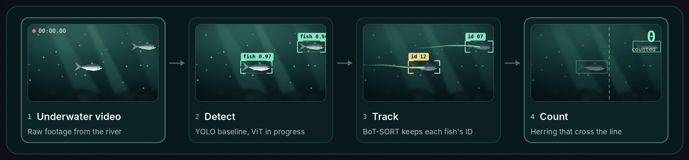

  <strong>Research Assistant · Computer Vision TA · AI Master's Student</strong> 
  Northeastern University · Boston, MA 
  <strong>Open to Spring 2027 co-ops in applied AI and ML</strong>

<!-- Paste your three existing LinkedIn, Outlook, and GitHub badge lines here. -->

## Hey, I'm Tejas 👋

I build computer vision systems and like figuring out where they break, from overlapping fish underwater to lane markings washed out by glare. At Northeastern, I also help students debug their own vision projects as a TA for **EECE/CS 5639**.

## 🐟 Research · Northeastern University × MIT Sea Grant

**Can we count river herring reliably when they overlap?** I prepared fish crops and tested a Vision Transformer classifier. Now I'm developing a ViT detector for full video frames. The next step is to compare it with YOLO on the same footage and see how each detector affects the final count.

## 🚗 Built · Lane & Object Detection

I built a road-video prototype that combines **OpenCV lane detection**, **YOLO object detection**, and **prioritized alerts**. I added a fallback for frames where glare made the lane estimate unreliable.

[Explore the code →](https://github.com/vanjaritejas/lane-and-object-detection)

**Tools I use** · `Python` · `PyTorch` · `OpenCV` · `YOLO` · `Hugging Face`

🏃 Off-screen, I'm working toward my first half marathon.
