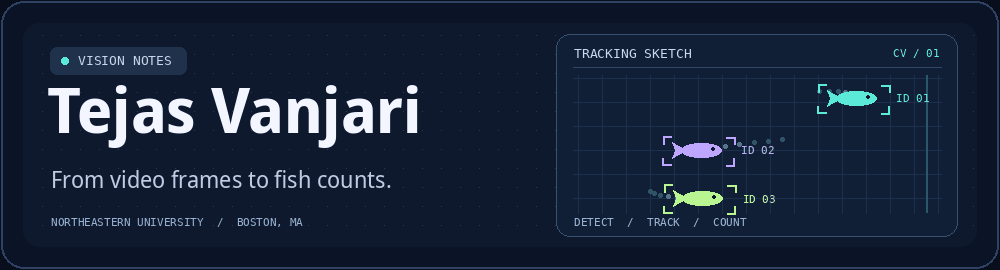

## Hey, I'm Tejas 👋

I'm an AI master's student and Computer Vision TA at Northeastern. I like building vision systems and finding the frames where they break.

📍 Boston, MA · **Open to Spring 2027 applied AI and ML co-ops**

### 🐟 Research · Northeastern University × MIT Sea Grant

As a research assistant, I work on counting river herring in crowded underwater video. I prepared fish crops and tested a Vision Transformer classifier. Now I'm developing a ViT detector to compare with the YOLO + BoT-SORT counting baseline.

### 🚗 Project · Lane & Object Detection

I built a road-video prototype that combines OpenCV lane detection, YOLO object detection, and prioritized alerts. I added a fallback for when glare makes lane estimates unreliable.

[Explore the code →](https://github.com/vanjaritejas/lane-and-object-detection)

`Python` · `PyTorch` · `OpenCV` · `YOLO` · `Hugging Face`

🏃 Away from my laptop, my next running goal is a half marathon.
