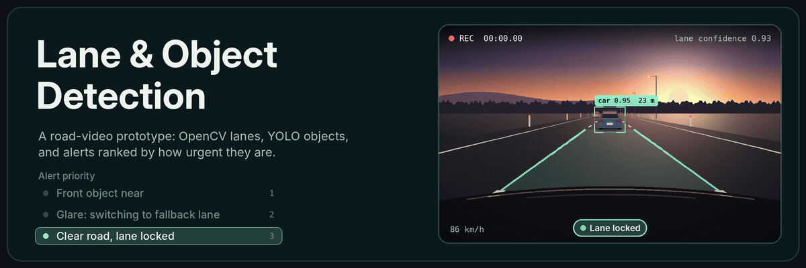

## Hey, I'm Tejas 👋

I build computer vision systems and like finding the frames where they break: fish swimming on top of each other, lane lines washed out by glare.

| 🔬 Researching | 🧑‍🏫 Teaching | 🎯 Looking for |
| :-- | :-- | :-- |
| Counting river herring in crowded underwater video with Northeastern and MIT Sea Grant | TA for **EECE/CS 5639**, helping students debug their own vision projects | A **Spring 2027 co-op** in applied AI or machine learning |

## 🐟 Research: counting river herring

**Can we count river herring reliably when they swim on top of each other?**

I started by preparing fish crops and testing a Vision Transformer classifier. Now I'm building a ViT detector for full video frames, so I can compare it with the YOLO baseline on the same footage and see how the choice of detector changes the final count.

## 🚗 Built: Lane & Object Detection

A road-video prototype that combines **OpenCV lane detection**, **YOLO object detection**, and **prioritized alerts**. I also added a fallback for frames where glare makes the lane estimate unreliable.

[View the code on GitHub](https://github.com/vanjaritejas/lane-and-object-detection)

## 🧩 In progress: Visual Question Answering

Comparing a **ViT + DistilBERT** model with a question-only baseline on VQA v2, to measure how much the image actually helps the answer.

[View the repo](https://github.com/vanjaritejas/Visual-Question-Answering-Bot)

## 🛠️ Tools I use

---

🏃 Off-screen, I'm training for my first half marathon.

